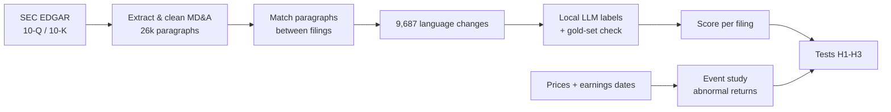
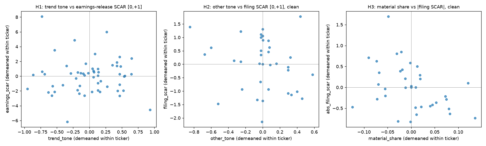

# FilingDelta

**Do changes in the language of SEC filings show up in stock prices, and with what lag?**

## Summary

- Built a pipeline that finds what changed in management's language (MD&A) between consecutive 10-Q / 10-K filings for 11 large US companies: **9,687 language changes**, separated from routine number updates.
- Labelled every change (topic, materiality, direction, forward-looking) with a **locally run LLM** (qwen3.5:9b via Ollama), validated against a hand-labelled, double-annotated gold set: topic and forward-looking agree with humans as well as the two annotators agreed with each other.
- Linked each filing's changes to its **abnormal stock return** in an event study (market model, SEC acceptance times, earnings releases tracked separately).
- **Finding:** for these large caps, a filing on its own moves the stock no more than an ordinary day does. The news reaches prices earlier, at the earnings release, so language changes cannot predict filing-day returns.


## Question and hypotheses

Every quarter, a company's MD&A (Management's Discussion & Analysis) explains in management's own words how the business went. Much of it is copied from the last filing with the numbers updated; sometimes the wording changes: a trend reverses, a risk appears, the outlook gets hedged. Do investors react to that, and when?

**H0:** the language changes in a filing are unrelated to the stock's abnormal return around it. Three alternatives, fixed before looking at any returns:

| | Hypothesis | Why |
|---|---|---|
| **H1** (sanity check) | Filings whose reported trends turned up ("decreased" → "increased") had better **earnings-release** returns | These changes restate results the market already saw at the release; tests whether the labels measure something real |
| **H2** (main question) | Filings whose other material changes (risk, outlook, legal, strategy, capital) read more positive had better **filing-day** returns | Where the filing could add something new |
| **H3** (size, not sign) | Filings with a larger share of materially changed paragraphs had **bigger** filing-day moves, up or down | Needs no direction label, the classifier's weakest field |

## Data

- **11 companies, 4 sectors:** banks JPM, MS; tech GOOGL, MSFT, NVDA; energy XOM, CVX, COP; consumer WMT, PG, KO. (Six other big banks were dropped: the parsing library returns the wrong section for their 10-Qs, without an error.)
- **88 filings** (6 10-Qs and 2 10-Ks each, 2024 to 2026) from SEC EDGAR, of which **56** have an earlier filing to compare with.
- Daily prices for the stocks, SPY and sector ETFs; each filing's earnings release from SEC (8-K Item 2.02).

## Method



**1. Extract and clean.** MD&A is pulled from each filing (Item 2 of a 10-Q, Item 7 of a 10-K) with edgartools, checked by rules (length, opening heading), and cleaned of page headers and footers, paragraphs split across pages, and 10-K text that runs on into the auditor's report. Result: 26,091 paragraphs tagged as text, heading or table.

**2. Find what changed.** Filings are paired by fiscal quarter: each 10-Q against the same quarter last year (removes seasonal wording) or the previous quarter, each 10-K against the previous 10-K. Paragraphs are matched regardless of order, because a positional diff (difflib) breaks on moved or lightly edited paragraphs:
- numbers, dates and period words are masked first, so "grew 17%" → "grew 20%" is a number update, not a language change;
- paragraphs are embedded with a local sentence-transformer (bge-small-en-v1.5) and paired one-to-one by optimal assignment (Hungarian algorithm) on cosine similarity, with thresholds set by reading samples per score band;
- direction words are also masked, for matching only, so "Xbox revenue *decreased*" finds "Xbox revenue *increased*" rather than "Azure revenue increased".

On 24 hand-checked changes, embedding matching was right on 24 and a fuzzy-string baseline (RapidFuzz) on 20. Each pair of paragraphs is labelled unchanged, numbers only, **reworded**, **added** or **removed**; the last three are the 9,687 language changes.

**3. Classify each change with a local LLM.** qwen3.5:9b through Ollama reads the old and new paragraph and returns, in a JSON schema that constrains it to valid values: topic (10 classes), materiality (0 nothing new, 1 extra detail, 2 changes the picture), direction (better / worse / no clear direction) and forward-looking. Greedy decoding, fixed seed, no thinking mode; the prompt went through six versions on a dev set, and gemma4:12b was compared and not kept (two off-by-two errors, 40% slower). The full run took 13.6 h on a laptop (5 s per change), with one failure.

To validate it, 50 changes were sampled (stratified by ticker and change type, split 35 dev / 15 test) and labelled blind by two annotators, the author and Claude (an LLM) as second annotator, under written guidelines ([labels/guidelines.md](labels/guidelines.md)), then adjudicated:

| Field | Model vs gold, kappa (95% CI, 49 items) | Test split only (14) | Annotator vs annotator |
|---|---|---|---|
| topic | 0.76 (0.62 to 0.88) | 0.83 | 0.79 |
| materiality | 0.33 (0.09 to 0.55), never off by two levels | 0.30 | 0.41 |
| direction | 0.31 (0.13 to 0.48), 8 of 9 signed changes right | 0.39 | 0.48 |
| forward-looking | 0.91 (0.65 to 1.00) | 1.00 | 1.00 |

Materiality and direction are hard for humans too (0.41 and 0.48 between annotators). The model's weak spot is giving a sign to neutral details, so the price test uses direction only on material (level 2) changes.

**4. Event study.** The event day is set from the SEC acceptance time (filed at or after the 4pm close → next trading day; the "filing date" on EDGAR is unreliable for this). A market model (stock return regressed on SPY over trading days −250 to −30) gives each day's expected return; the abnormal returns are summed over days [0,+1] and [0,+5] (CAR) and divided by their standard error (SCAR), so volatile and calm stocks are comparable. The same is done for each filing's earnings release. MSFT, GOOGL, NVDA and COP file 10-Qs on earnings day, so filing-day tests use the **36 filings with no earnings release in the window**.

**5. Test.** Each filing gets scores from its material changes, split by a word rule into **trend** changes (the first direction word flipped, or "low single digits" → "mid single digits") and **other** material changes (risk, outlook, legal, strategy, capital, credit, macro). Tone = (positive − negative) / (positive + negative). Correlations are Spearman after subtracting each company's average (PG writes 39% of its changes as material, JPM 8%: that is style, not news), with p-values from 10,000 permutations within ticker, since 11 companies are too few for clustered standard errors. Nothing is fitted, so with 56 filings there is no train/test split to overfit.

## Results

| Test | n | rho (within company) | p |
|---|---|---|---|
| H1: trend tone vs earnings-release return | 56 | 0.06 | 0.71 |
| H2: other tone vs filing-day return [0,+1] | 36 | −0.20 | 0.27 |
| H2, robustness: [0,+5] | 36 | −0.37 | 0.04 |
| H3: material share vs size of filing-day move | 36 | −0.43 | 0.02 |
| H3, robustness: [0,+5] | 36 | −0.21 | 0.26 |

None passes the corrected threshold for 8 tests (0.05 / 8 = 0.006), and the two below 0.05 point the opposite way to the hypothesis; H3 falls to −0.27 (p 0.24) when one filing per company is dropped.



Why the filing-day tests are empty shows once you ask whether filing days carry any news at all. A SCAR is scaled so that a no-news day averages 0.80 in size, with 5% of days beyond ±1.96:

| Days | n | Average size of move | Moves beyond ±1.96 |
|---|---|---|---|
| No news (theory) | | 0.80 | 5% |
| **Filing, no earnings release in window** | 36 | **0.81** (95% CI 0.63 to 1.01) | **3%** |
| Filing on earnings day | 20 | 2.53 | 45% |
| Earnings release | 56 | 1.97 | 39% |

(This check was added after H2 and H3 came back null; it uses no labels.)

## Findings

1. **A 10-Q or 10-K on its own carries no price news for these companies.** Filing days look exactly like ordinary days, and the interval rules out a reaction more than ~25% larger than normal. The answer to "with what lag?" is that the information reaches prices **before** the filing, at the earnings release and call.
2. **So language changes cannot line up with filing-day returns**, whatever their tone or amount (H2, H3).
3. **MD&A language tracks change against last year; prices react to results against expectations.** Year-over-year trend language did not line up with the earnings-day reaction either (H1), nor, exploratory, with the stock's return over the comparison year. The labels are validated by the gold set, not by prices.
4. This matches research on 10-K/10-Q language changes ("Lazy Prices", Cohen, Malloy and Nguyen, 2020), which also finds no filing-day reaction, but returns that drift slowly over the following months across thousands of firms: a horizon this sample is too small to test.

## Limitations

- **Small sample:** 56 filings, 36 clean; only correlations of about ±0.33 or stronger were detectable.
- **Large, heavily covered companies**, where filings are least likely to be news; smaller firms may differ.
- **The labels are imperfect:** about half of the model's "material" ratings are right on the gold set, which is why scores are averaged per filing. The gold set has 50 items and its second annotator is an LLM.
- **The trend / other split is a word rule** and misses reversals not stated with a direction word first.
- **Earnings confound:** for 4 of 11 companies the filing and earnings reactions cannot be separated; they are left out of the filing-day tests.

Details of every step, the choices behind them and the known data issues: [docs/methods.md](docs/methods.md).

## Next steps

- More filings: hundreds of companies including small caps, 5+ years, and returns over months (the drift found in the literature).
- Risk Factors changes from 10-Ks.
- Retrieval over the classified changes to explain what changed in a given filing.

## Running it

Python 3.13; [Ollama](https://ollama.com) with `qwen3.5:9b` for the classifier. SEC requires a name and email with every request: set `SEC_IDENTITY` in `src/config.py`.

```bash
python3 -m venv .venv && source .venv/bin/activate
pip install -r requirements.txt
```

```bash
python -m src.ingest && python -m src.validate     # download filings, extract and check MD&A
python -m src.clean && python -m src.pairs         # paragraphs, filing pairs
python -m src.embed && python -m src.diff --method embedding   # match paragraphs, label changes
python -m src.prices && python -m src.earnings && python -m src.event_study   # returns
python -m src.classify --items all                 # LLM labels (~14 h, resumable)
python -m src.evaluate --split test                # score against the gold set
python -m src.price_test                           # tests and figures (~10 s)
```

```
src/          one module per pipeline step (ingest, validate, clean, pairs, embed, diff,
              prices, earnings, event_study, sample_gold, classify, evaluate, price_test)
labels/       annotation guidelines, gold set, hand check of the matching
notebooks/    exploration: EDGAR parsing, diff baseline, embeddings, prompt development
docs/         methods and known issues, figures
data/         generated by the pipeline (not committed)
```
