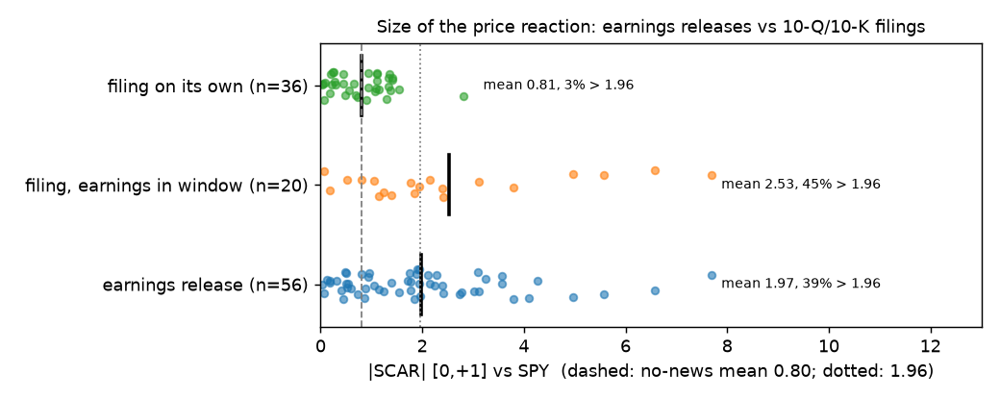

# FilingDelta

**Research question:** Do changes in the language of SEC filings (10-Qs and 10-Ks) show up in stock prices, and with what lag?

FilingDelta pulls company filings from SEC EDGAR, extracts the sections where management's language changes from quarter to quarter, measures what changed, and tests whether those changes predict stock moves.

> Status: first full pass done (11 companies, 56 filings tested). Findings below.

## Findings

1. **In this sample, a 10-Q or 10-K carries no price news of its own.** On the 36 filing days with no earnings release in the window, the abnormal return is the size of an ordinary day's: mean |SCAR| 0.81 (95% CI 0.63 to 1.01) against 0.80 expected with no news, and 1 of 36 days (3%) beyond ±1.96 against 5% expected. The earnings releases for the same filings: mean 1.97, 39% beyond ±1.96. The interval rules out a filing-day reaction more than about 25% larger than an ordinary day's. So for these companies, the answer to "with what lag?" is that the language reaches prices *before* the filing, at the earnings release (press release and call), and nothing measurable is left for the filing day.
2. **So the classified changes don't line up with filing-day returns.** Tone of material changes about risk, outlook, legal matters, strategy and capital vs the filing-day return: rho −0.20, p = 0.27. Share of paragraphs with a material change vs the size of the move: rho −0.43, p = 0.023, but in the opposite direction to the hypothesis, above the 0.006 threshold for 8 tests, and −0.27 (p = 0.24) when one filing per ticker is dropped: not a finding.
3. **The sanity check failed, which says something about what MD&A measures.** Changes where a named line turned up or down (trend tone) do not line up with the earnings-release return (rho 0.06, p = 0.71), nor, exploratory, with the stock's return over the comparison year (rho −0.13). MD&A describes the quarter against last year; the market reacts to results against expectations, and a year-over-year improvement is usually expected. The classifier's labels are therefore validated by the gold set, not by prices.



What it would take to see an effect: research on 10-K and 10-Q language changes ("Lazy Prices", Cohen, Malloy and Nguyen, 2020) finds them predicting returns slowly, over months, across thousands of firms, not in the days after filing. Testing that needs far more filings than 56 and smaller, less-covered companies, where the filing is more likely to be the first disclosure.

All tests were specified before returns were looked at (`src/price_test.py` docstring), except the filing-day news check, added after the main tests came back null. Correlations are Spearman after demeaning within ticker, with p-values from 10,000 permutations within ticker (11 tickers are too few clusters for clustered standard errors).

## Approach

- **MD&A, quarter over quarter.** Management's Discussion & Analysis is extracted from every 10-Q and 10-K (Item 2 in a 10-Q, Item 7 in a 10-K). This is the main, frequent signal.
- **Risk Factors, year over year (backlog).** 10-Q risk factor sections are usually just a pointer to the annual report, so risk factor changes would have to come from 10-Ks, annually.
- There is no Q4 10-Q: the 10-K covers Q4, so 8 quarters = 6 10-Qs + 2 10-Ks.

Why section extraction matters: a single JPMorgan 10-Q is ~1.2M characters (~300k tokens), mostly tables and boilerplate. MD&A is ~22% of it.

## Companies

11 large caps across four sectors:

| Sector | Tickers |
|---|---|
| Banks | JPM, MS |
| Tech / AI | GOOGL, MSFT, NVDA |
| Energy | XOM, CVX, COP |
| Consumer | WMT, PG, KO |

The ticker list is in `src/config.py`.

## Project structure

```
data/processed/{ticker}/{period}_mdna.txt   extracted MD&A text (not committed; regenerate with the pipeline)
data/processed/{ticker}/{period}_mdna_clean.txt   cleaned MD&A, one block per paragraph, for reading (raw file left untouched)
data/processed/paragraphs.csv               one row per paragraph, all filings: kind (text / heading / table), section, text
data/processed/manifest.csv                 one row per filing: form, accession, acceptance time, fiscal year / quarter, file path, validation flags
data/processed/pairs.csv                    which filing is compared with which (yoy, qoq, annual)
data/processed/changes.csv                  one row per matched / added / removed paragraph per pair, with change label (fuzzy matching)
data/processed/changes_embedding.csv        same, with embedding matching
data/processed/embeddings_*.npy             bge-small paragraph vectors: masked (for matching) and raw (for retrieval)
data/processed/embeddings_index.csv         which paragraph each vector row belongs to
data/processed/prices.csv                   daily adjusted closes: 11 tickers, SPY, sector ETFs
data/processed/earnings.csv                 one row per filing: the earnings release (8-K Item 2.02) that preceded it
data/processed/events.csv                   abnormal returns: filing / earnings x SPY / sector ETF x CAR window
data/processed/classified/*.jsonl           classifier results, one file per model, prompt version and item set
data/processed/filing_features.csv          one row per tested filing: language scores and abnormal returns
docs/figures/                               figures from src/price_test.py
labels/diff_handcheck.csv                   24 hand-annotated changes.csv rows (label correct? + note): diff matching check
labels/guidelines.md                        annotation rules for the change classifier (the same rules as its prompt)
labels/gold_items.csv                       50 gold items (35 dev / 15 test), sampled by src/sample_gold.py
labels/gold_labels.csv                      adjudicated gold labels, with both annotators' original labels
src/sample_gold.py                          reproducible stratified sample of gold items
notebooks/01_explore_edgar.ipynb            exploration of EDGAR filings and section extraction, with findings
notebooks/02_diff_sanity.ipynb              difflib baseline on MSFT (why paragraph matching must ignore order)
notebooks/03_explore_diff.ipynb             building blocks of diff.py on one MSFT pair
notebooks/04_embeddings_model.ipynb         embedding model tests, fuzzy vs embedding disagreements, threshold calibration
src/config.py                               tickers, forms, SEC identity
src/ingest.py                               ingestion pipeline: fetch filings, extract MD&A, save, write manifest
src/validate.py                             flag MD&A that is too short, too long or doesn't start like MD&A
src/clean.py                                clean MD&A and split it into labelled paragraphs
src/pairs.py                                build pairs.csv from the manifest
src/diff.py                                 match paragraphs between paired filings and label the changes
src/embed.py                                embed every text paragraph (masked and raw)
src/prices.py                               download daily prices (yfinance)
src/earnings.py                             match each filing to its earnings release on SEC
src/event_study.py                          event days, market model, cumulative abnormal returns
src/classify.py                             label each change with a local LLM (Ollama): topic, materiality, direction, forward_looking
src/evaluate.py                             score a classifier run against the gold labels
src/price_test.py                           per-filing language scores and the three price tests
```

## Setup

Python 3.13.

```bash
python3 -m venv .venv
source .venv/bin/activate
python -m pip install -r requirements.txt
```

SEC EDGAR requires a name and email with every request. Set `SEC_IDENTITY` in `src/config.py` to your own.

## Running

From the project root:

```bash
python -m src.ingest                  # download + extract MD&A for all tickers, write manifest
python -m src.ingest --manifest-only  # MD&A already on disk: fetch metadata only, write manifest
python -m src.ingest --tickers MSFT   # one ticker
python -m src.validate                # add validation flags to the manifest (rerun after every ingest)
python -m src.clean                   # clean MD&A, write paragraphs.csv
python -m src.pairs                   # build pairs.csv from the manifest
python -m src.diff                    # match paragraphs per pair, write changes.csv (~1 min)
python -m src.diff --tickers MSFT     # some tickers: print a report, don't write
python -m src.embed                   # embed paragraphs (local model, a few minutes)
python -m src.diff --method embedding # embedding matching, write changes_embedding.csv
python -m src.prices                  # download prices, write prices.csv
python -m src.earnings                # find each filing's earnings release, write earnings.csv
python -m src.event_study             # abnormal returns, write events.csv
python -m src.sample_gold             # write labels/gold_items.csv
python -m src.classify --items gold --split dev   # classify the dev gold items (Ollama running)
python -m src.evaluate --split dev    # score that run against the gold labels
python -m src.classify --items all    # classify all 9,687 changes (~14 h, resumable)
python -m src.price_test              # filing scores, price tests, figures (~10 s)
```

`src.ingest` downloads the last 6 10-Qs and 2 10-Ks for each ticker, extracts MD&A, and writes one text file per filing period to `data/processed/`, plus `manifest.csv` with each filing's metadata. Filings that fail are logged and skipped, and a saved / skipped summary is printed per ticker.

`src.pairs` pairs filings on fiscal year / quarter: **yoy** (10-Q vs the same fiscal quarter last year, the primary comparison since it removes seasonal wording), **qoq** (10-Q vs the previous 10-Q in the same fiscal year), and **annual** (10-K vs prior 10-K). Amendments are excluded. The current window gives 78 pairs: 33 yoy, 34 qoq, 11 annual.

`src.diff` compares the text paragraphs of each pair (tables left out: their changes are number updates). Numbers, percentages, $ amounts, dates and period words ("three months", "second quarter") are masked first, so "revenue grew 17%" → "20%" is a number update, not a language change. Every old paragraph is scored against every new one (RapidFuzz `token_sort_ratio`, case-insensitive), then paired one-to-one with optimal assignment (Hungarian algorithm), so a paragraph that moved still finds its partner. Labels: **unchanged** (same text), **numbers_only** (same after masking), **reworded**, **added**, **removed**. Result: 18,636 rows over 78 pairs; a median 95% of old paragraphs find a partner in qoq pairs, 82% in yoy, 84% in annual.

**Event study.** Each filing's event day is the first trading day the market could react: the acceptance day, or the next trading day if accepted at or after the 4pm ET close (acceptance time from the SEC filing header). A market model (OLS of the stock's daily return on the benchmark's, trading days −250 to −30) gives the expected return; abnormal returns are summed over [0,+1], [−1,+1] and [0,+5]. Two benchmarks: SPY and the ticker's SPDR sector ETF (XLF, XLK, XLC, XLE, XLP). The same is done for each filing's earnings release, taken from SEC: the latest 8-K with Item 2.02 (Results of Operations) accepted after the quarter ended and before the filing. All 88 filings have one.

How far filings trail earnings decides what can be measured:

| Filing vs earnings release | Tickers |
|---|---|
| Same trading day (filing reaction = earnings reaction) | GOOGL, MSFT, NVDA; COP 10-Qs |
| 1-2 trading days later | XOM, KO, PG 10-Qs |
| 4-25 trading days later | CVX, JPM, MS, WMT, and every 10-K |

**Embedding matching.** `src.embed` encodes every text paragraph with a local sentence-transformers model, `BAAI/bge-small-en-v1.5` (384 dimensions, 512-token input: truncates 0.2% of paragraphs, vs 1.4% for `all-MiniLM-L6-v2`). `src.diff --method embedding` scores pairs by cosine similarity instead of RapidFuzz, with the same one-to-one matching and labels. Before embedding, direction words ("increased", "lower", ...) are masked as well as numbers, for matching only: otherwise "Xbox revenue increased 8%" matched "Azure revenue increased 40%" over "Xbox revenue decreased 5%". Labels still see the flip (`reworded`). Compared with fuzzy, the two methods pick the same best partner for 89% of MSFT paragraphs; where they differ, embeddings fix topic confusion (M365 *Commercial* vs *Consumer*, one segment's gross margin vs another's), and the remaining disagreements are mostly ties between near-identical quarter / year-to-date copies. Embedding scores show a step in the same-section rate at cosine 0.84 that fuzzy scores lacked. Thresholds: 0.86 within a section, 0.92 across, +0.01 same-section tie-break. Result: 18,220 rows; 424 more paragraphs matched as reworded, 416 fewer each added and removed.

**Gold set for the change classifier.** 50 changes (reworded / added / removed), sampled with a fixed seed and a per-ticker quota (2 reworded, 1 added, 1 removed, plus 6 reworded), excluding rows seen while writing the prompt; split 35 dev / 15 test before labelling. Fields: topic, materiality (0 / 1 / 2), direction, forward_looking, from an investor's point of view, by the written rules in `labels/guidelines.md`. Two annotators labelled independently: the author, and Claude (an LLM) as second annotator, each blind to the other. Agreement on 49 items (one excluded as a matching error): forward_looking 100% (Cohen's kappa 1.00), topic 82% (0.79), direction 69% (0.48), materiality 61% (0.41; 96% within one level). Nearly all materiality disagreements went one way (the author rated higher on 16 items, lower on 3). Four rules settled 19 of the 32 disagreements and were added to the guidelines: materiality 2 is strict (new or removed risk, changed outlook, reversed trend, new legal matter, major event); a paragraph removed or added only because the new filing carries its own version is 0 (flagged as a likely matching miss); topic is the paragraph's subject, `other` only when nothing fits; direction is `not_applicable` only at materiality 0. The other 13 were adjudicated item by item. Result: 49 scored items (23 materiality 0, 21 materiality 1, 5 materiality 2) plus one `bad_match`.

**Change classifier.** `src.classify` labels each change with a local model, qwen3.5:9b through Ollama, given a versioned system prompt that states the same rules as the guidelines and a JSON schema that constrains the output to the allowed values (no thinking mode; greedy decoding with a fixed seed). Runs are resumable: one JSON line per item, appended as it finishes, failures recorded and retried. Development used the 35-item dev split: prompt versions v1 to v6, a comparison with gemma4:12b (slightly better on direction, but 40% slower and two off-by-two false "material" labels, so qwen was kept), and dropping a `change_kind` field neither annotators nor models applied consistently. Scores against the gold labels (`src.evaluate`), test split scored once (14 items), and over all 49 gold items with 95% bootstrap intervals:

| Field | Test kappa | All 49: agreement | All 49: kappa (95% CI) | Annotators' kappa |
|---|---|---|---|---|
| topic | 0.83 | 80% | 0.76 (0.62 to 0.88) | 0.79 |
| materiality | 0.30 | 59% (100% within one level) | 0.33 (0.09 to 0.55) | 0.41 |
| direction | 0.39 | 49% | 0.31 (0.13 to 0.48) | 0.48 |
| forward_looking | 1.00 | 98% | 0.91 (0.65 to 1.00) | 1.00 |

Topic and forward_looking are at the level of the two annotators; materiality is never off by more than one level, but its kappa interval is wide. Of 8 changes the model rated materiality 2, 4 are material in the gold set (it found 4 of the 5). Direction is right on 8 of 9 clearly positive or negative changes; the weak score comes from giving a sign to unsigned details. The 49-item figures include the dev items used while developing the prompt, so they are somewhat optimistic; the 14-item test scores are unbiased but very noisy.

**Full run.** All 9,687 changes, 13.6 h at 5.0 s per change on a laptop; 9,686 labelled, 1 failure (the model wrote its reasoning into `reason` until it ran out of tokens), no breaks of the consistency rules. Materiality 0 / 1 / 2: 36% / 48% / 15%. The share rated 2 ranges from 8% (JPM) to 39% (PG): PG states segment growth in words ("increased low single digits" → "mid-single digits"), which number masking can't hide, so its number changes reach the model as wording.

**Price test.** `src.price_test` scores each filing on one comparison (a 10-Q against the same quarter last year, a 10-K against the previous 10-K; the previous quarter only where no year-ago filing is in the window), using only the changes rated materiality 2. A rule splits them: **trend** changes, where the paragraph's first direction word flipped ("decreased" → "increased") or its growth size changed (566 changes), and **other** material changes, excluding those about revenue or costs, which on reading were mostly the reported numbers again (430). Tone = (positive − negative) / (positive + negative), from the classifier's direction. Hypotheses: trend tone goes with the earnings-release return (sanity check); other tone goes with the filing-day return (the research question); the share of materially changed paragraphs goes with the size of the filing-day move (needs no direction label). Returns are SCARs (CAR divided by its standard error, comparable across tickers) over [0,+1], with [0,+5] as a robustness check. Filing-day tests use the 36 filings without an earnings release in the window. Results are under Findings.

| Test | n | rho (within ticker) | p |
|---|---|---|---|
| Trend tone vs earnings-release SCAR | 56 | 0.06 | 0.71 |
| Other tone vs filing SCAR [0,+1] | 36 | −0.20 | 0.27 |
| Other tone vs filing SCAR [0,+5] | 36 | −0.37 | 0.04 |
| Material share vs \|filing SCAR\| [0,+1] | 36 | −0.43 | 0.02 |
| Material share vs \|filing SCAR\| [0,+5] | 36 | −0.21 | 0.26 |

Eight tests in all (in the script's output); Bonferroni threshold 0.006, and the two below 0.05 have the opposite sign to the hypothesis.

## Known issues and limitations

- **Silent parser failures on large banks.** For BAC, WFC, C, GS, PNC and USB, `edgartools` section extraction either can't find 10-Q MD&A or returns the wrong section (e.g. BAC's share repurchase table in place of MD&A; WFC's financial statement notes). WFC's 10-K MD&A is in Exhibit 13. These banks are excluded for now, so the bank sector is thin. Details in `notebooks/01_explore_edgar.ipynb`.
- **"Saved" does not mean "correct."** `src.validate` flags MD&A under 3,000 words, over 2× the ticker's 10-Q median (5× for 10-Ks, which run 0.9-3.9× it), or without an MD&A heading in its first 500 characters. Current run: 2 of 88 flagged, both JPM 10-Ks, real MD&A that opens with ~800 words of financial highlights; reviewed and kept as valid, with the flag on record.
- **MD&A extraction runs into Item 8 for CVX, JPM and XOM 10-Ks.** edgartools' Item 7 continues into management's report on internal control and the auditor's report (4-22% of the text). None of the validation checks catches it. `src.clean` cuts at the first standalone Item 8 heading; without that, changing audit-report wording would show up as language changes in annual pairs.
- **Cleaning is rule-based, so it has known misses.** `src.clean` drops page numbers, footers and running headers (short lines that repeat *next to a page break*; a first version that dropped every repeated short line also removed real segment headings and number-only sentences), re-joins paragraphs cut by a page break (only when the cut is clearly mid-sentence: the second half starts lowercase, or the first ends in a lowercase word or comma), and tags tables. XOM's 2026 10-Qs come out of edgartools hard-wrapped (a blank line after every printed line); the join rule puts them back together, and their paragraph lengths now match XOM's other 10-Qs. Known misses: a few real headings that usually sit at a page top are dropped (JPM "Quarterly results", XOM "Volume / Mix", KO/PG "Nine months ended ... versus ..."); some tables made mostly of column headers stay tagged as text; a split whose second half starts with "(" or whose first half ends in a capitalised word stays as two paragraphs. Result: 26,091 paragraphs (19,305 text, 4,661 headings, 2,125 tables).
- **Fiscal calendars differ** (MSFT and PG end in June, NVDA and WMT in January, KO and NVDA use 52/53-week years), so filings are aligned by fiscal quarter, derived from SEC's fiscal year end, never by calendar date.
- **Filing date is not the event date.** SEC gives filings accepted after 5:30pm ET the next business day's filing date (all 8 GOOGL filings, one PG). Event timing uses the acceptance time from the filing header instead, with a 4pm cutoff for the next trading day.
- **Earnings confound.** Some companies (e.g. MSFT, GOOGL, NVDA) file the 10-Q on the evening of their earnings release, so the filing's event day is also the earnings reaction day. Others file weeks after earnings (JPM, MS, WMT file 2-4 weeks after their quarter's results). Earnings dates need to be recorded per filing and controlled for.
- **Small sample.** The 8-filing window gives 56 filings with a comparison, 36 of them not on an earnings day, so only correlations of about |0.3| or more are detectable. Raising the 10-Q window from 6 to ~9 quarters would add about 33 filings; the real fix is more companies.
- **Fuzzy matching has a precision / recall trade-off with no clean cut-off.** Best-match scores don't split into two clear groups: 60-80 mixes real rewrites with look-alike template sentences (MSFT's "X increased $N or N% driven by Y" under every segment, JPM's "Equity Markets revenue" vs "Fixed Income Markets revenue"). Thresholds were set by reading samples per score band: a match needs 65 within the same section, 80 across sections, and same-section partners get a small tie-break bonus. Some wrong partners remain in the 65-80 band (roughly 1 in 4 there), which inflates "reworded" and hides some added / removed paragraphs. This is the baseline that embeddings are compared against.
- **Embedding matching shares two limits with fuzzy.** Cross-section matches are right only ~60% of the time even above cosine 0.92, and a higher score doesn't help: the errors are segment templates (XOM "Margin –" in Chemical vs Energy Products; MSFT operating expenses in two segments) that read alike to any text-similarity method, while the correct ones are mostly renamed or mislabelled headings. Comparing headings fuzzily instead of exactly would help both methods (backlog). Also, masking directions makes very short template sentences identical across segments ("Revenue <DIR> <XX> or <XX>%."), so the same-section tie-break decides those. Thresholds come from ~8 samples per score band: judgement calls, kept apart from the hand-check rows used to evaluate.
- **Hand check of 24 change rows** (stratified by label, 9 tickers; 10 reworded, half of them from the 65-80 score band), then re-checked against embedding matching. Fuzzy gets 20 of 24 right. One miss is a wrong partner at score 66 (JPM: a CECL footnote matched to an unrelated capital-ratio footnote). The other three were first marked correct and relabelled after embedding matching found their partners: two "added" JPM paragraphs (card income, a segment cross-reference) and one "removed" KO paragraph (quarterly SG&A) are rewrites of paragraphs in the other filing, scored 0.89-0.98 by embeddings but below the fuzzy thresholds. The first verdicts had trusted fuzzy's "no partner": added / removed rows have to be labelled by searching the other filing, not by checking the tool's output. Embedding matching makes the same decision as fuzzy on the other 20 rows, so it gets all 24 right (one, the cross-reference, is borderline). Two caveats: 24 rows is a direction, not a significant difference, and the rows were sampled from fuzzy's output, which can't show fuzzy misses beyond its 6 added / removed rows. "Reworded" means the wording changed, not that the meaning did: some are grammar knock-ons of period updates (WMT "for both the three and six months" → "the three and nine months"). Judging materiality is left to the change classifier.
- **No "moved" label.** A flag for "matched paragraph now under a different heading" was tried and dropped: section labels from clean.py are too noisy (renamed headings, a "Table of Contents" section, headings attached to the wrong paragraphs), and all 3 flags in the hand check were wrong. JPM alone had 391, because its 10-Qs repeat sentences under both "Quarterly results" and "Year-to-date results".
- **The filing reaction can't be separated from earnings for GOOGL, MSFT, NVDA (and COP 10-Qs)**: they file the 10-Q on the same day as the results, so the filing's CAR is the earnings CAR. 34% of filings have the earnings day inside their [0,+1] window, 50% inside [−1,+1] (`earnings_in_window` in events.csv). Tests of the filing text have to use the separable filings or control for the earnings reaction.
- **Neither benchmark fits every ticker.** Over 2025-26, consumer staples and energy moved almost independently of the S&P 500 (estimated betas vs SPY: KO 0.04, PG −0.02, XOM 0.23; XLP itself −0.03 since mid-2025), so SPY removes little of their market-wide moves and the sector model is more informative. For tech the sector model is biased the other way: MSFT and NVDA are a large part of XLK (as XOM is of XLE and GOOGL of XLC), so part of their own move is subtracted out. Market-wide shocks still leak in: MS's 10-Q event window (2024-11-05/06) contains the post-election bank rally, +9.5% vs SPY but +3.8% vs XLF.
- **XOM changed registrant on 2026-07-01** (redomiciled to Texas; ExxonMobil Holdings Corp, CIK 2115436, is the successor). Its earnings 8-K for Q2 2026 is under the new CIK, the Q2 10-Q still under the old one (34088). `src/earnings.py` searches both (`EXTRA_CIKS` in config); future XOM 10-Qs will need the new CIK in ingestion too.
- **Half-day sessions** (day before July 4, day after Thanksgiving, Christmas Eve) close at 1pm, but the event-day rule assumes 4pm. No filing in the sample was accepted on one.
- **Material-2 labels are about half right** (4 of 8 on the gold set), so the price test averages them per filing rather than using single changes. The trend / other split is a word rule: it misses reversals stated without a direction word first, and its sign is the number's (a cost that "decreased" is +), which is why the price test takes the sign from the classifier's direction instead (they agree on 82% of trend changes).
- **The classifier rarely says a change has no clear direction.** On the dev split, qwen3.5:9b got the direction right on every clearly positive or negative change (6 of 6), but gave a sign, mostly positive, to 10 of 12 changes the gold set marks as unsigned (a newly named driver, a factual detail). Renaming the label from `neutral_or_mixed` to `no_clear_direction` did not change this (prompt v6). The price test therefore uses direction only on material (level 2) changes. The same rerun showed how noisy 35 items are: a rename that left materiality untouched moved 2 materiality labels and its kappa from 0.44 to 0.35.
- **The gold set is small and its second annotator is an LLM.** With only 5 materiality-2 items, accuracy on that class is noisy (a test split of 14 scored items holds even fewer), so classifier results should be reported with per-class counts and the within-one-level rate, not as a single accuracy. The second annotator was Claude, not a second person, a common compromise for a one-person project; Claude also drafted the guidelines, so its labels may follow the written rules more literally than a second human would.
- **MD&A length grows through the fiscal year** (Q1 shortest), need to check if this is actually a real trend, or just an anomaly. If it is, it has to be normalized.

## Roadmap

- [x] Ingest MD&A for 11 companies × 8 quarters
- [x] Filing manifest (acceptance time, fiscal quarter) and pairing rule: 78 pairs
- [x] Validation step for extracted sections
- [x] Text cleaning: Item 8 trim, page junk, page-split paragraphs, section labels, table tags
- [x] Paragraph-level diffing between quarters (order-independent matching)
- [x] Separate meaningful language changes from number updates
- [x] Stock price data, earnings dates and event-study setup
- [x] Paragraph embeddings (local bge-small) and embedding-based matching vs the fuzzy baseline
- [x] Evaluate fuzzy vs embedding matching on the hand-checked rows (fuzzy 20 / 24, embedding 24 / 24)
- [x] Gold set for change classification: 50 items, two blind annotators, adjudicated
- [x] LLM change classifier (local model) built and evaluated on the gold set
- [x] Classify all 9,687 changes
- [x] Price test: language scores vs filing-day and earnings-day abnormal returns
- [ ] More filings: longer window, more and smaller companies, returns over months
- [ ] Risk Factors changes from 10-Ks
- [ ] RAG / LLM layer to explain what changed
